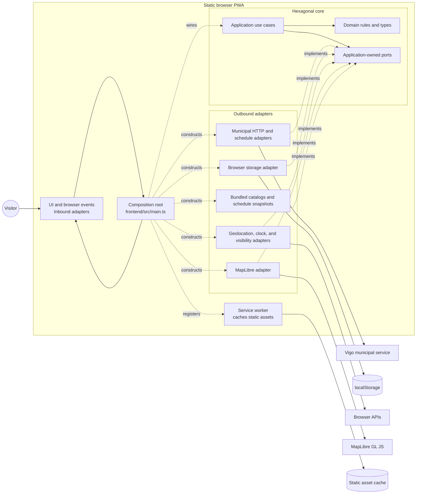

| [Castellano](README.md) | [Galego](README.gl.md) | **English** |
| --- | --- | --- |

# Vigo Bus Navigator

> Explore Vigo bus lines, stops, published schedules, and arrivals in a static,
> offline-friendly web app. The browser reads public municipal data directly.

## Purpose and boundaries

Vigo Bus Navigator is a community-built, browser-first PWA for urban transit in
Vigo, Spain. It supports line and stop discovery, service by weekday/Saturday/
Sunday and holidays, arrivals where available, and locally saved favorites.

The project is static and client-only: it has no application backend, transit
proxy, account system, or application-level activity tracking. When a live
profile is enabled, the browser makes fixed, credential-free GET requests to
the municipal service. This is not an official Vitrasa service.

## Architecture

Runtime code follows hexagonal boundaries: domain and application modules own
rules and use cases; browser, municipal, storage, and mapping integrations are
adapters; [the composition root](./frontend/src/main.ts) wires them together.
The maintained source inventory and dependency rules are checked in tests.



- [Runtime architecture and local checks](./docs/architecture.md)
- [Architecture inventory and isolated-test mappings](./frontend/tests/architecture/modules.json)
- [Harness Charter](./docs/harness-charter.md), authoritative for project agents
  and required review gates

## OpenAPI documentation

Read the [application OpenAPI portal](https://jorgebg90.github.io/vigo-bus-navigator/docs/openapi/).
The build validates and publishes all current contracts:

- [Municipal JSP transport and normalized models](./specs/004-vigo-jsp-transit-api/contracts/municipal-transit-v5.openapi.yaml).
- [Municipal autocomplete and address models](./specs/011-bus-itinerary-search/contracts/address-geocoding.openapi.yaml).
- [OTP planning and journey models](./specs/011-bus-itinerary-search/contracts/route-planning.openapi.yaml).
- [External CARTO map resources](./specs/011-bus-itinerary-search/contracts/map-resources.openapi.yaml).

Each integration sits behind an application port and outbound adapter.
`x-hexagonal` maps contracts to the use cases, ports, adapters and internal models.
See the [current architecture](./docs/architecture.md).
For a local preview, run `npm run build` and `npm run preview`, then open
[`/docs/openapi/`](http://127.0.0.1:4173/docs/openapi/). It is static contract
documentation—not a hosted API, backend, or transit proxy.

The portal uses self-hosted Swagger UI with expandable operations/schemas,
contract navigation and read-only YAML. No CDN or external validator is used.
“Try it out” is disabled so documentation cannot bypass application ports/adapters.

## Get started

Requirements: Node.js 22 and npm.

```bash
npm ci
npm run dev
```

`npm run dev` uses the `local-live` municipal profile configured in
`frontend/.env.development`; it calls the fixed municipal source directly from
the browser. Set `VITE_MUNICIPAL_PROFILE=fixture` to use synthetic responses
without JSP network traffic. This profile does not disable autocomplete or OTP;
interactive address/journey searches still call those services. E2E tests
explicitly replace both with fixtures.

## Validation

```bash
npm run typecheck
npm test
npm run test:coverage
npm run test:e2e
npm run lint:openapi
npm run validate:municipal-api-contract
npm run build
npm run size
```

The test and browser profiles use fixtures and do not call the municipal
service. Run `npm run build` before `npm run size`; the latter enforces the
first-map and per-file budgets. For base-path checks, use
`VITE_BASE_PATH=/ npm run build` or
`VITE_BASE_PATH=/vigo-bus-navigator/ npm run build`. The deployed GitHub Pages
build uses the latter path.
Run the Playwright E2E suite locally during development; it is not part of the
GitHub Actions pull-request check.

## Data sources and availability

The municipal integration lives in
[`frontend/src/infrastructure/municipal`](./frontend/src/infrastructure/municipal)
and is coordinated by the frontend schedule repository. It owns the fixed
action allowlist, bounded GET transport, source normalization, identity checks,
provenance, and local cache behavior. It is browser code, not a Cloudflare
Worker, serverless function, or separately hosted API.

| Municipal profile | Behavior |
| --- | --- |
| `fixture` | Deterministic synthetic JSP responses; no JSP traffic. |
| `local-live` | Fixed-origin browser GETs with credentials omitted. |
| `production` | Direct browser GETs for the supported municipal action allowlist. |

These profiles govern JSP only, not OTP/autocomplete or external map resources.
Tests and E2E builds select `fixture` explicitly and inject journey-service fixtures.
`VITE_PROFILE=production` and
`VITE_MUNICIPAL_PROFILE=production` select the static-host build profile. No
separately hosted transit URL is accepted by configuration.

Live profiles support municipal stop/line/service catalogs, arrivals, line/day
schedules and schedule-derived route geometry and trip stops. Detailed line-stop
context remains limited to its approved mapping. The bundled catalog is a dated,
non-exhaustive discovery fallback, not live coverage.

Point-to-point search uses municipal autocomplete (replacing Photon) and OTP
through separate ports. It shows alternatives, walking/bus directions, times,
transfers, selectable stops and returned route geometry. Scheduled versus realtime
data and empty versus failed requests remain distinct. Offline mode cannot perform
new predictions or route calculations. Localhost access was verified; verify the
actual production origin before release.

## Privacy and security

Favorites and settings stay in browser `localStorage`; there are no user
profiles, credentials, or accounts. Entered address text goes to municipal
autocomplete; selected endpoint coordinates and departure date/time go to OTP
when planning. This includes current location if selected as an endpoint.
Searches, coordinates and journey history are not persisted. JSP lookups use
public transit IDs; the map provider receives viewport-related resource requests.
Providers may process ordinary connection metadata under their own policies.

The service worker caches static frontend assets and the generated OpenAPI
pages, not external API responses. JSP receipt caches retain their own freshness
rules; autocomplete and OTP use `cache: no-store` without persistence.
No secrets or backend URL are required.

## Project workflow

The repository uses Spec-Driven Development with GitHub Spec Kit, plus a
project-agent harness that reviews design, implementation, accessibility, and
acceptance at defined gates. The charter is the source of truth for all eight
agents and gate assignments; use it rather than an abbreviated actor list.

The Spec Kit command flow is:

```text
/speckit-constitution → /speckit-specify → /speckit-clarify (optional)
→ /speckit-plan → /speckit-tasks → /speckit-analyze (optional)
→ /speckit-implement → /speckit-converge
```

The charter assigns G1 to all actors; G2 to Stakeholder, QA Tester, UX
Designer, and Frontend Developer; G3 to Software Architect, Backend Developer,
UX Designer, and Frontend Developer; G4 to QA Tester, UX Designer, and
Frontend Developer; and G5 to QA Tester, Stakeholder, UX Designer, Frontend
Developer, and Software Architect. G6 is the Communicator review of each
phase's blog documentation, not a phase assigned to `/speckit-converge`.

Feature specifications, plans, tasks, and gate verdicts live under `specs/`;
custom agents and skills are in `.github/agents/` and `.github/skills/`.
Operational details and review ownership are documented in the
[Harness Charter](./docs/harness-charter.md).

## Repository layout

```text
.specify/           Spec Kit templates, scripts, and constitution
.github/agents/     Project custom agents
.github/skills/     Spec Kit workflows
docs/               Architecture, harness charter, and blog series
frontend/           Static browser application and tests
scripts/            Contract checks, generators, and build tooling
postman/            Manual municipal-source request collection
specs/              Feature specs, plans, tasks, and verdicts
```

## Status

Automated coverage includes Node unit tests, DOM tests, fixture-based
integration, Playwright browser checks, and accessibility scans. Install
Playwright browsers with `npx playwright install` when they are not already
available.

## License

Apache-2.0 — see [LICENSE](./LICENSE) and [NOTICE](./NOTICE).
