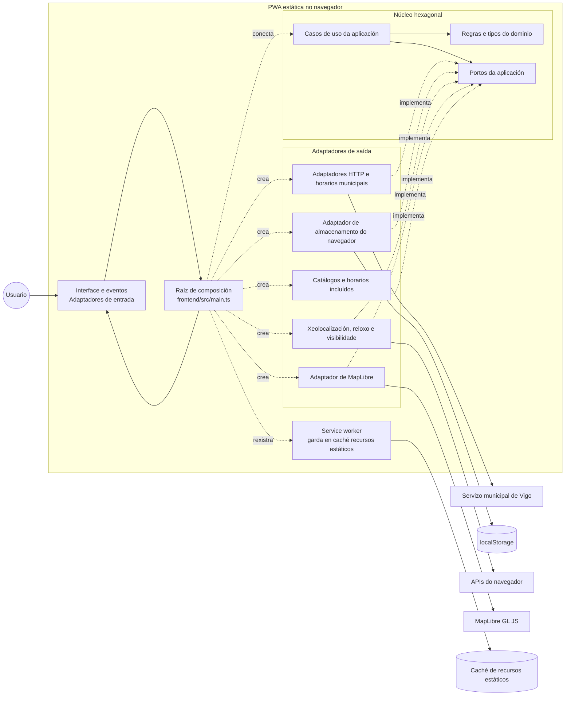

| [Castellano](README.md) | **Galego** | [English](README.en.md) |
| --- | --- | --- |

# Navegador de autobuses de Vigo

> Explora liñas, paradas, horarios publicados e chegadas dos autobuses de Vigo
> nunha aplicación web estática que pode funcionar sen conexión. O navegador
> consulta directamente os datos públicos municipais.

## Propósito e límites

Navegador de autobuses de Vigo é unha PWA comunitaria, centrada no navegador,
para o transporte urbano de Vigo. Permite buscar liñas e paradas, consultar os
servizos de días laborables, sábados, domingos e festivos, ver chegadas cando
están dispoñibles e gardar favoritos localmente.

O proxecto é estático e só funciona no cliente: non ten backend de aplicación,
proxy de transporte, contas de usuario nin seguimento da actividade. Cando se
activa un perfil con datos en directo, o navegador fai peticións GET fixas e
sen credenciais ao servizo municipal. Non é un servizo oficial de Vitrasa.

## Arquitectura

O código de execución segue límites hexagonais: o dominio e a aplicación
conteñen as regras e os casos de uso; as integracións co navegador, cos datos
municipais, co almacenamento e co mapa actúan como adaptadores; e a
[raíz de composición](./frontend/src/main.ts) conéctaos. Os tests comproban o
inventario do código fonte e as regras de dependencias.



- [Arquitectura de execución e comprobacións locais](./docs/architecture.md)
- [Inventario de arquitectura e tests illados](./frontend/tests/architecture/modules.json)
- [Carta do arnés de axentes](./docs/harness-charter.md), documento de referencia
  para os axentes do proxecto e as revisións obrigatorias

## Documentación OpenAPI

Consulta o [contrato OpenAPI do transporte municipal](https://jorgebg90.github.io/vigo-bus-navigator/docs/openapi/).
A páxina xérase durante a compilación a partir do
[contrato OpenAPI en YAML](./specs/004-vigo-jsp-transit-api/contracts/municipal-transit-v5.openapi.yaml).
Para vela localmente, executa `npm run build` e `npm run preview`; despois abre
[`/docs/openapi/`](http://127.0.0.1:4173/docs/openapi/). É documentación HTML
estática do contrato, non unha API aloxada, un backend nin un proxy de transporte.

## Comezar

Requisitos: Node.js 22 e npm.

```bash
npm ci
npm run dev
```

`npm run dev` usa o perfil municipal `local-live` configurado en
`frontend/.env.development`; consulta a fonte municipal directamente desde o
navegador. Define `VITE_MUNICIPAL_PROFILE=fixture` para usar respostas
sintéticas sen tráfico de rede municipal.

## Validación

```bash
npm run typecheck
npm test
npm run test:coverage
npm run test:e2e
npm run lint:openapi
npm run validate:municipal-api-contract
npm run build
npm run size
```

Os tests e os perfís de navegador usan datos de proba e non consultan o servizo
municipal. Executa `npm run build` antes de `npm run size`; o segundo comando
comproba os límites de tamaño do primeiro mapa e de cada ficheiro. Para probar
unha ruta base, usa `VITE_BASE_PATH=/ npm run build` ou
`VITE_BASE_PATH=/vigo-bus-navigator/ npm run build`. A compilación despregada en
GitHub Pages usa esta última ruta.
Executa a suite E2E de Playwright localmente durante o desenvolvemento; non
forma parte da validación das PR en GitHub Actions.

## Fontes de datos e dispoñibilidade

A integración municipal está en
[`frontend/src/infrastructure/municipal`](./frontend/src/infrastructure/municipal)
e coordínase mediante o repositorio de horarios da aplicación. Encárgase da
lista permitida de accións, do transporte GET limitado, da normalización da
fonte, das comprobacións de identidade, da procedencia e da caché local. É
código do navegador, non un Worker de Cloudflare, unha función serverless nin
unha API aloxada por separado.

| Perfil municipal | Comportamento |
| --- | --- |
| `fixture` | Respostas sintéticas deterministas; non consulta o servizo municipal. |
| `local-live` | Peticións GET desde o navegador á orixe fixa, sen credenciais. |
| `production` | Peticións GET directas do navegador para as accións municipais permitidas. |

Os tests e as compilacións E2E seleccionan explicitamente `fixture`.
`VITE_PROFILE=production` e `VITE_MUNICIPAL_PROFILE=production` seleccionan o
perfil de compilación para aloxamento estático. A configuración non admite
ningunha URL de transporte aloxada por separado.

O catálogo GTFS/de datos abertos incluído é unha semente de descubrimento
datada e non exhaustiva para paradas e alternativas textuais ordenadas de
percorrido; non se presenta como unha resposta municipal en directo. Os
catálogos municipais de liñas e servizos, as liñas que pasan por unha parada e
as chegadas en directo mostran a procedencia da fonte. Os horarios de proba
son sintéticos e así se identifican. Nos perfís en directo, os horarios reais
seguen sen estar dispoñibles ata que exista unha correspondencia entre os
identificadores de horario e os códigos dos días de servizo; a aplicación non
a deduce dos metadatos do servizo. A xeometría dos percorridos, a secuencia
das viaxes e os detalles das paradas tamén seguen sen estar dispoñibles ata
que se implementen as correspondencias necesarias. As peticións fallidas ou
os datos de orixe non válidos producen estados de indispoñibilidade, non
horarios sen verificar.

## Privacidade e seguridade

Os favoritos e a configuración gárdanse no `localStorage` do navegador; non
hai perfís de usuario, credenciais nin contas. A aplicación non envía a
localización precisa nin a actividade da persoa usuaria á fonte de transporte.
Nos perfís `local-live` e `production`, o servizo municipal recibe a petición
de rede do navegador e identificadores públicos do transporte. Vigo e o
provedor de aloxamento estático poden procesar metadatos de conexión segundo
as súas propias políticas.

O service worker garda na caché recursos estáticos da interface e o documento
OpenAPI xerado, pero non as respostas da API municipal. Non fan falta segredos
nin unha URL de backend.

## Fluxo de traballo do proxecto

O repositorio utiliza Spec-Driven Development con GitHub Spec Kit e un arnés
de axentes do proxecto que revisa o deseño, a implementación, a accesibilidade
e a aceptación en etapas definidas. A carta é a fonte de referencia para os
oito axentes e as súas revisións; úsaa no canto dunha lista abreviada de roles.

O fluxo de comandos de Spec Kit é:

```text
/speckit-constitution → /speckit-specify → /speckit-clarify (opcional)
→ /speckit-plan → /speckit-tasks → /speckit-analyze (opcional)
→ /speckit-implement → /speckit-converge
```

A carta asigna G1 a todos os axentes; G2 a Stakeholder, QA Tester, UX Designer
e Frontend Developer; G3 a Software Architect, Backend Developer, UX Designer
e Frontend Developer; G4 a QA Tester, UX Designer e Frontend Developer; e G5
a QA Tester, Stakeholder, UX Designer, Frontend Developer e Software Architect.
G6 é a revisión do Communicator da documentación do blog de cada fase, non unha
fase asignada a `/speckit-converge`.

As especificacións, os plans, as tarefas e os resultados das revisións están
baixo `specs/`; os axentes e as habilidades personalizadas están en
`.github/agents/` e `.github/skills/`. Os detalles operativos e a
responsabilidade das revisións están na
[Carta do arnés](./docs/harness-charter.md).

## Estrutura do repositorio

```text
.specify/           Modelos, scripts e constitución de Spec Kit
.github/agents/     Axentes personalizados do proxecto
.github/skills/     Fluxos de traballo de Spec Kit
docs/               Arquitectura, carta do arnés e serie de artigos
frontend/           Aplicación estática do navegador e tests
scripts/            Validacións de contratos, xeradores e ferramentas de compilación
postman/            Colección de peticións manuais á fonte municipal
specs/              Especificacións, plans, tarefas e revisións
```

## Estado

A cobertura automatizada inclúe tests unitarios de Node, tests do DOM,
integración con datos de proba, comprobacións do navegador con Playwright e
análises de accesibilidade. Instala os navegadores de Playwright con
`npx playwright install` se aínda non están dispoñibles.

## Licenza

Apache-2.0 — consulta [LICENSE](./LICENSE) e [NOTICE](./NOTICE).
