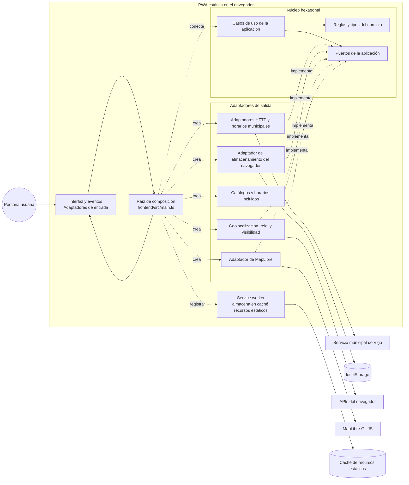

| **Castellano** | [Galego](README.gl.md) | [English](README.en.md) |
| --- | --- | --- |

# Navegador de autobuses de Vigo

> Explora líneas, paradas, horarios publicados y llegadas de autobuses de Vigo
> en una aplicación web estática que puede funcionar sin conexión. El navegador
> consulta directamente los datos públicos municipales.

## Propósito y límites

Navegador de autobuses de Vigo es una PWA comunitaria, centrada en el navegador,
para el transporte urbano de Vigo. Permite buscar líneas y paradas, consultar
los servicios de días laborables, sábados, domingos y festivos, ver llegadas
cuando están disponibles y guardar favoritos localmente.

El proyecto es estático y solo funciona en el cliente: no tiene backend de
aplicación, proxy de transporte, cuentas de usuario ni seguimiento de la
actividad. Cuando se activa un perfil con datos en directo, el navegador hace
peticiones GET fijas y sin credenciales al servicio municipal. No es un
servicio oficial de Vitrasa.

## Arquitectura

El código de ejecución sigue límites hexagonales: el dominio y la aplicación
contienen las reglas y los casos de uso; las integraciones con el navegador,
los datos municipales, el almacenamiento y el mapa actúan como adaptadores; y
la [raíz de composición](./frontend/src/main.ts) los conecta. Los tests
comprueban el inventario del código fuente y las reglas de dependencias.



- [Arquitectura de ejecución y comprobaciones locales](./docs/architecture.md)
- [Inventario de arquitectura y pruebas aisladas](./frontend/tests/architecture/modules.json)
- [Carta del arnés de agentes](./docs/harness-charter.md), documento de referencia
  para los agentes del proyecto y las revisiones obligatorias

## Documentación OpenAPI

Consulta el [contrato OpenAPI del transporte municipal](https://jorgebg90.github.io/vigo-bus-navigator/docs/openapi/).
La página se genera durante la compilación a partir del
[contrato OpenAPI en YAML](./specs/004-vigo-jsp-transit-api/contracts/municipal-transit-v5.openapi.yaml).
Para verla localmente, ejecuta `npm run build` y `npm run preview`; después
abre [`/docs/openapi/`](http://127.0.0.1:4173/docs/openapi/). Es documentación
HTML estática del contrato, no una API alojada, un backend ni un proxy de
transporte.

## Primeros pasos

Requisitos: Node.js 22 y npm.

```bash
npm ci
npm run dev
```

`npm run dev` usa el perfil municipal `local-live` configurado en
`frontend/.env.development`; consulta la fuente municipal directamente desde
el navegador. Define `VITE_MUNICIPAL_PROFILE=fixture` para usar respuestas
sintéticas sin tráfico de red municipal.

## Validación

```bash
npm run typecheck
npm test
npm run test:coverage
npm run test:e2e
npm run lint:openapi
npm run validate:municipal-api-contract
npm run build
npm run size
```

Las pruebas y los perfiles de navegador usan datos de prueba y no consultan el
servicio municipal. Ejecuta `npm run build` antes de `npm run size`; el segundo
comando comprueba los límites de tamaño del primer mapa y de cada archivo. Para
probar una ruta base, usa `VITE_BASE_PATH=/ npm run build` o
`VITE_BASE_PATH=/vigo-bus-navigator/ npm run build`. La compilación que se
despliega en GitHub Pages usa esta última ruta.
Ejecuta la suite E2E de Playwright localmente durante el desarrollo; no forma
parte de la validación de las PR en GitHub Actions.

## Fuentes de datos y disponibilidad

La integración municipal está en
[`frontend/src/infrastructure/municipal`](./frontend/src/infrastructure/municipal)
y se coordina mediante el repositorio de horarios de la aplicación. Se
encarga de la lista permitida de acciones, del transporte GET limitado, de la
normalización de la fuente, de las comprobaciones de identidad, de la
procedencia y de la caché local. Es código del navegador, no un Worker de
Cloudflare, una función serverless ni una API alojada por separado.

| Perfil municipal | Comportamiento |
| --- | --- |
| `fixture` | Respuestas sintéticas deterministas; no consulta el servicio municipal. |
| `local-live` | Peticiones GET desde el navegador a un origen fijo, sin credenciales. |
| `production` | Peticiones GET directas del navegador para las acciones municipales permitidas. |

Las pruebas y las compilaciones E2E seleccionan explícitamente `fixture`.
`VITE_PROFILE=production` y `VITE_MUNICIPAL_PROFILE=production` seleccionan el
perfil de compilación para alojamiento estático. La configuración no admite
ninguna URL de transporte alojada por separado.

El catálogo GTFS/de datos abiertos incluido es una semilla de descubrimiento
fechada y no exhaustiva para paradas y alternativas textuales ordenadas de
recorrido; no se presenta como una respuesta municipal en directo. Los
catálogos municipales de líneas y servicios, las líneas que sirven una parada
y las llegadas en directo muestran la procedencia de la fuente. Los horarios
de prueba son sintéticos y se identifican como tales. En los perfiles en
directo, los horarios reales siguen sin estar disponibles hasta que exista
una correspondencia entre los identificadores de horario y los códigos de
días de servicio; la aplicación no la deduce de los metadatos del servicio.
La geometría de los recorridos, la secuencia de viajes y los detalles de las
paradas también siguen sin estar disponibles hasta que se implementen las
correspondencias necesarias. Las peticiones fallidas o los datos de origen no
válidos producen estados de indisponibilidad, no horarios sin verificar.

## Privacidad y seguridad

Los favoritos y la configuración se guardan en el `localStorage` del
navegador; no hay perfiles de usuario, credenciales ni cuentas. La aplicación
no envía la ubicación precisa ni la actividad de las personas usuarias a la
fuente de transporte. En los perfiles `local-live` y `production`, el servicio
municipal recibe la petición de red del navegador e identificadores públicos
del transporte. Vigo y el proveedor de alojamiento estático pueden procesar
metadatos de conexión según sus propias políticas.

El service worker almacena en caché recursos estáticos de la interfaz y el
documento OpenAPI generado, pero no las respuestas de la API municipal. No
hacen falta secretos ni una URL de backend.

## Flujo de trabajo del proyecto

El repositorio utiliza Spec-Driven Development con GitHub Spec Kit y un arnés
de agentes del proyecto que revisa el diseño, la implementación, la
accesibilidad y la aceptación en etapas definidas. La carta es la fuente de
referencia para los ocho agentes y sus revisiones; úsala en lugar de una lista
abreviada de roles.

El flujo de comandos de Spec Kit es:

```text
/speckit-constitution → /speckit-specify → /speckit-clarify (opcional)
→ /speckit-plan → /speckit-tasks → /speckit-analyze (opcional)
→ /speckit-implement → /speckit-converge
```

La carta asigna G1 a todos los agentes; G2 a Stakeholder, QA Tester, UX
Designer y Frontend Developer; G3 a Software Architect, Backend Developer,
UX Designer y Frontend Developer; G4 a QA Tester, UX Designer y Frontend
Developer; y G5 a QA Tester, Stakeholder, UX Designer, Frontend Developer y
Software Architect. G6 es la revisión del Communicator de la documentación
del blog de cada fase, no una fase asignada a `/speckit-converge`.

Las especificaciones, los planes, las tareas y los resultados de las
revisiones están bajo `specs/`; los agentes y las habilidades personalizadas
están en `.github/agents/` y `.github/skills/`. Los detalles operativos y la
responsabilidad de las revisiones están en la
[Carta del arnés](./docs/harness-charter.md).

## Estructura del repositorio

```text
.specify/           Plantillas, scripts y constitución de Spec Kit
.github/agents/     Agentes personalizados del proyecto
.github/skills/     Flujos de trabajo de Spec Kit
docs/               Arquitectura, carta del arnés y serie de artículos
frontend/           Aplicación estática del navegador y pruebas
scripts/            Validación de contratos, generadores y herramientas de compilación
postman/            Colección de peticiones manuales a la fuente municipal
specs/              Especificaciones, planes, tareas y revisiones
```

## Estado

La cobertura automatizada incluye pruebas unitarias de Node, pruebas del DOM,
integración con datos de prueba, comprobaciones del navegador con Playwright y
análisis de accesibilidad. Instala los navegadores de Playwright con
`npx playwright install` si todavía no están disponibles.

## Licencia

Apache-2.0 — consulta [LICENSE](./LICENSE) y [NOTICE](./NOTICE).
