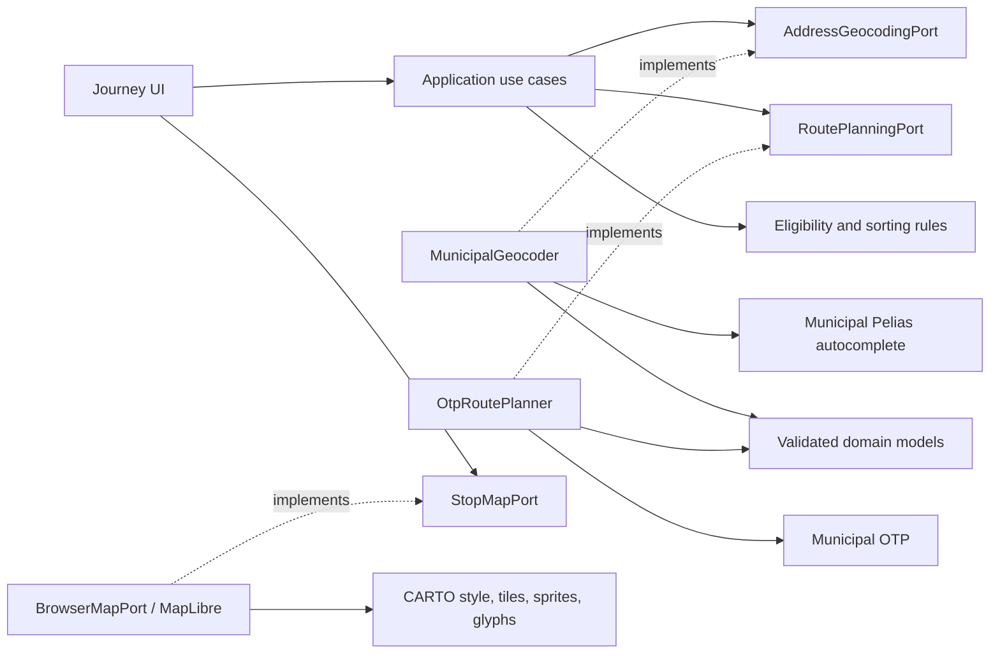

# Runtime architecture

**Current implementation: 2026-11-13.** This document describes runtime code,
not historical proposals in feature specifications or blog entries.

The application is a browser-first static PWA. Production behavior is divided
into domain rules, application use cases and ports, adapters, and a narrow
composition root. The maintained runtime-module inventory and its isolated
test mappings live in
[`frontend/tests/architecture/modules.json`](../frontend/tests/architecture/modules.json);
[`frontend/tests/unit/architecture.test.ts`](../frontend/tests/unit/architecture.test.ts)
checks that inventory and the dependency graph on every unit-test run.

## Module responsibilities

Every maintained executable module under `frontend/src` appears exactly once
in the inventory with one primary responsibility:

| Responsibility | Meaning |
| --- | --- |
| `domain` | Framework-independent entities, values, and business rules. |
| `application-use-case` | Coordinates domain behavior through application ports. |
| `application-port` | Platform-neutral interfaces owned by the application layer. |
| `inbound-adapter` | UI, browser event, localization-binding, or service-worker entry behavior. |
| `outbound-adapter` | Browser storage, municipal data, mapping, clock, and other platform integrations. |
| `presentation-localization` | User-facing translations and presentation-only localization helpers. |
| `composition` | Application entry-point wiring; not a place for business rules. |
| `service-worker` | PWA lifecycle and offline behavior. |

Modules assigned `composition`, `service-worker`, or
`presentation-localization` include a rationale in the manifest because those
roles are cross-cutting or intentionally isolated from ordinary layer rules.
If source code is added, moved, or removed, update the inventory and ensure
domain rules and application use cases retain isolated Node test mappings.

## Dependency directions

Dependencies point inward. Domain modules may depend only on domain modules.
Application use cases may depend on domain, other application use cases, and
application ports; ports may depend on domain and other ports. Neither core
layer may depend on platform adapters, browser APIs, network APIs, persistence,
or unclassified external packages.

Inbound and outbound adapters may use core modules and adapter-local helpers,
but may not depend on each other. Presentation localization may support
inbound presentation behavior, not domain or application logic. The service
worker may use its own modules and outbound integrations. Composition may
construct adapters and connect ports to use cases, but must delegate schedule
repository operations to application use cases. The AST guard rejects direct
or extracted references to schedule repository methods from the composition
root, including property and literal element access.

The architecture checker discovers executable TypeScript/JavaScript modules
independently of entry-point reachability, compares them with the manifest,
and parses imports, re-exports, type-only dependencies, and literal dynamic
imports using the TypeScript AST. It resolves relative and `@/` source aliases,
and reports unresolved local edges, undeclared external dependencies,
unclassified or stale manifest entries, prohibited layer edges, and forbidden
ambient browser/network/storage globals in domain and application modules.
Known non-code resources and Vite virtual imports are treated separately from
runtime source modules.

## Local validation

From the repository root:

```sh
npm test -- frontend/tests/unit/architecture.test.ts
npm test -- frontend/tests/unit
npm run typecheck
```

The architecture suite includes regression fixtures for inventory drift,
dependency syntax and resolution, layer violations, direct or extracted
repository-method references from composition, forbidden globals, and isolated
test mappings. Domain and application tests run in Vitest's Node environment
and use injected ports rather than browser persistence or live network
services.

## External contracts and hexagonal boundaries

Every external data integration belongs behind an application-owned port and
an outbound adapter. UI, domain and application modules do not call HTTP or
consume provider DTOs. The composition root constructs implementations and
injects them into use cases; it does not turn provider endpoints into domain
interfaces. A direct browser request is still an adapter call, not a bypass of
the hexagon. There is no application-hosted HTTP API, backend, proxy or Worker.

The [OpenAPI portal](https://jorgebg90.github.io/vigo-bus-navigator/docs/openapi/)
publishes all current contracts, including normalized in-process schemas and
`x-hexagonal` metadata. HTTP paths describe real upstream endpoints only;
in-process ports and domain models are not fictitious REST operations.
The viewer is self-hosted Swagger UI, not Swagger Editor: contracts cannot be
edited or executed from the documentation. Its JS/CSS assets are copied from the
pinned npm lockfile during generation and only loaded by documentation pages,
not the application entry point. The service worker precaches these assets for
offline viewing. No external validator/CDN receives a contract. YAML and complete
architecture/source policy extensions remain available in read-only disclosures.
The server list is static because request execution is disabled; a Swagger
component override removes its unnecessary server selector. Hash deep links
are disabled to avoid nested links inside the operation toggle buttons.

| Integration | Application boundary | Outbound implementation | Source contract / model |
| --- | --- | --- | --- |
| Municipal catalogs, published schedules, shapes and trip stops | `ScheduleRepositoryV5`, `LineScheduleGateway` | [MunicipalScheduleRepository](../frontend/src/infrastructure/schedule/municipal-schedule-repository.ts) and [municipal adapters](../frontend/src/infrastructure/municipal/) | [JSP OpenAPI](../specs/004-vigo-jsp-transit-api/contracts/municipal-transit-v5.openapi.yaml); [domain types](../frontend/src/domain/types.ts) |
| Stop arrival estimates | `MunicipalArrivalsGateway` | Municipal arrivals adapter and bounded HTTP client | Same JSP contract; `ArrivalReceipt`, source provenance and failure types |
| Address predictions | `AddressGeocodingPort` via `searchAddressSuggestions` | [MunicipalGeocoder](../frontend/src/infrastructure/geocoding/municipal-geocoder.ts) | [Autocomplete OpenAPI](../specs/011-bus-itinerary-search/contracts/address-geocoding.openapi.yaml); [AddressSuggestion / AddressSearchResult](../frontend/src/domain/journey-address.ts) |
| Point-to-point bus planning | `RoutePlanningPort` via `planJourneySearch` | [OtpRoutePlanner](../frontend/src/infrastructure/routing/otp-route-planner.ts) | [OTP OpenAPI](../specs/011-bus-itinerary-search/contracts/route-planning.openapi.yaml); [TransitJourney / RoutePlanningResult](../frontend/src/domain/transit-journey.ts) |
| External map rendering resources | `StopMapPort` | [BrowserMapPort](../frontend/src/infrastructure/map/map-port.ts), containing MapLibre | [CARTO resource OpenAPI](../specs/011-bus-itinerary-search/contracts/map-resources.openapi.yaml); domain supplies map stops and route geometry, never tiles |

All ports are declared in [application/ports.ts](../frontend/src/application/ports.ts).
Browser geolocation, clock, visibility and storage are platform ports, not HTTP
APIs; bundled catalogs and static application assets are not external transit
services. Attribution links are navigation, not data-source API requests.



### Source DTOs versus application models

- Pelias `gid` becomes `AddressSuggestion.id`; `label` (or `name`) becomes
  display text; GeoJSON `[longitude, latitude]` becomes named point properties.
  Keep the first five distinct valid venue/street results within Vigo coverage.
- OTP legs become `TransitJourneyLeg`: epochs stay milliseconds, durations
  seconds and distances meters; encoded polylines become `[longitude, latitude]`
  arrays. Scheduled legs (`realTime: false`) are not live countdowns.
- OTP stop IDs are provider-namespaced. Do not equate them with municipal or
  Vitrasa IDs; itinerary stop selection focuses the supplied coordinates.
- Municipal catalog adapters validate source identity and normalize models
  with provenance. Published schedules use public line codes and day selectors
  `1`/`6`/`0`; shape and trip requests use IDs returned by schedule rows.
- Port results distinguish success, unavailable and (where supported)
  cancellation. Malformed or failed requests are not successful empty results.
  JSON Schema documents structure; decoder and use-case tests additionally
  enforce chronology, coordinate coverage, identity and eligibility.

### Journey flow and current capabilities

1. Paired origin/destination inputs debounce predictions by 350 ms. The use case
   validates text (3–180 characters), then delegates to municipal autocomplete
   with fixed `layers=venue,street&lang=es`. Photon is no longer used.
2. Select a suggestion, nearby catalog stop or current location; map taps do
   not change endpoints. Date/time is interpreted in Europe/Madrid; invalid or
   ambiguous DST input is rejected.
3. Planning validates the query and calls OTP through its port. The application
   enforces 500 m straight-line endpoint-to-stop radii, at most two transfers
   and 300 m straight-line transfer connectors. Provider walking limits alone
   are insufficient; actual walking paths may exceed these straight-line radii.
4. Alternatives are sorted and selectable, with ordered walking/bus steps,
   intermediate stops and selectable boarding/alighting stops. Map geometry is
   returned by OTP, not invented straight-line bus connections.
5. Editing inputs or navigating invalidates/cancels pending work and clears
   stale results. Changing the selected alternative updates details and map;
   theme remount restores the selection.

Autocomplete requests have a 5 s timeout and 256 KiB response bound. OTP uses
15 s and 2 MiB. Both use fixed HTTPS hosts, GET, omitted credentials/referrers,
rejected redirects and `cache: no-store`; queries and responses remain in memory.

### Profiles, availability and privacy

`VITE_MUNICIPAL_PROFILE` selects JSP fixture/live behavior only. It does **not**
disable the separate autocomplete and OTP adapters: interactive journey searches
call those services in every profile. Automated journey tests inject deterministic
fetch fixtures for both; setting the JSP profile to `fixture` alone is not a
network-isolation guarantee. CARTO resources are also external renderer traffic.

Live JSP supports the online stop catalog, line/day schedules and schedule-derived
trip sequences/shapes. Detailed line-stop context remains constrained to its
approved mapping. Bundled discovery is a dated, non-exhaustive fallback, not a
claim of live network coverage. An offline shell does not supply offline address
predictions or route planning.

Address text is transmitted to municipal autocomplete; selected coordinates
(including current location if selected) and requested departure time go to OTP.
Favorites/preferences may be stored locally; address queries, coordinates and
journey history are not persisted or cached by the application. The map provider
sees requested viewport/tile coordinates and ordinary connection metadata. The
service worker precaches static assets and generated OpenAPI pages, not external
API responses. Existing JSP receipt caches are separate and have their own
freshness/provenance rules; they do not contain journey queries.

Local browser checks proved autocomplete and OTP access on 2026-11-13. They do
not prove production-origin CORS compatibility or an upstream SLA. Verify the
actual deployed origin before release.

## Maintaining API coherence

For any new or changed external integration:

1. Define/reuse application ports and normalized domain models.
2. Document the fixed upstream request/response, allowed parameters, failure,
   privacy and cache semantics in OpenAPI. Add `x-hexagonal` mapping; distinguish
   source payloads from in-process schemas.
3. Implement validation/normalization in an outbound adapter; inject it at
   composition. Do not add fetch calls to UI, use cases or domain.
4. Register its contract in [openapi-contracts.ts](../scripts/openapi-contracts.ts)
   and the `lint:openapi` command. The build validates and generates all four
   current contract pages; relative links work with static-host base paths.
5. Update the runtime inventory and isolated tests, then verify decoder output
   against documented normalized schemas and browser behavior against fixtures.
   Record live-origin checks separately from deterministic tests.
