# Harness Charter

> How the actor harness validates the Vigo Bus Navigator solution at every
> Spec-Driven Development gate.

## Paradigm

The **harness paradigm** wraps the GitHub Spec Kit lifecycle with a fixed cast
of actors. Each actor owns a dimension of quality and must record an explicit
verdict before the project moves to the next phase. The Project Lead
orchestrates; the constitution is the final arbiter of disagreements.

## Actors

| Actor | Agent file | Dimension owned |
| --- | --- | --- |
| Project Lead | [.github/agents/project-lead.agent.md](../.github/agents/project-lead.agent.md) | Orchestration, delivery, gate discipline |
| Software Architect | [.github/agents/software-architect.agent.md](../.github/agents/software-architect.agent.md) | Design, boundaries, pure-frontend architecture |
| Backend Developer | [.github/agents/backend-developer.agent.md](../.github/agents/backend-developer.agent.md) | Data contracts, `localStorage` persistence |
| QA Tester | [.github/agents/qa-tester.agent.md](../.github/agents/qa-tester.agent.md) | Testability, coverage, quality gates |
| Stakeholder | [.github/agents/stakeholder.agent.md](../.github/agents/stakeholder.agent.md) | User value, scope, acceptance sign-off |
| Communicator | [.github/agents/communicator.agent.md](../.github/agents/communicator.agent.md) | Blog-ready documentation of the process |

## Validation Gates

Every SDD phase closes with a gate. Verdicts are appended to the phase
artifacts under `specs/` using each actor's verdict format.

```mermaid
flowchart LR
    A[Constitution] -->|G1: all actors ratify| B[Specify]
    B -->|G2: Stakeholder + QA| C[Clarify]
    C -->|G3: Architect + Backend Dev| D[Plan]
    D -->|G4: QA testability review| E[Tasks]
    E -->|G5: QA quality + Stakeholder acceptance| F[Implement]
    F -->|G6: Communicator story gate| G[Converge]
```



| Gate | Phase | Required verdicts |
| --- | --- | --- |
| G1 | Constitution | All actors |
| G2 | Specify | Stakeholder, QA Tester |
| G3 | Plan | Software Architect, Backend Developer |
| G4 | Tasks | QA Tester |
| G5 | Implement | QA Tester, Stakeholder |
| G6 | Each phase | Communicator (blog draft exists and is accurate) |

## Verdict Format

```markdown
### <Actor> Verdict — <phase> — <YYYY-MM-DD>
- Verdict: APPROVED | CHANGES REQUESTED
- Findings: <bullet list>
- Required actions: <bullet list or "none">
```

A gate is **closed** when every required verdict is `APPROVED`. A
`CHANGES REQUESTED` verdict blocks the phase until the actions are resolved
and the actor re-approves.

## Working Agreements

- Everything is written in English.
- Clean code and YAGNI: the simplest solution that passes its gate wins.
- The product stays pure frontend: static hosting on GitHub Pages, user data
  in `localStorage`, no backend, no accounts.
- Blog drafts live in `docs/blog/`, one per phase, maintained by the
  Communicator.
