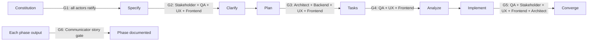

# Harness Charter

> How the actor harness validates the Vigo Bus Navigator solution at every
> Spec-Driven Development gate.

## Paradigm

The **harness paradigm** wraps the GitHub Spec Kit lifecycle with a fixed cast
of actors. Each actor owns a dimension of quality and must record an explicit
verdict before the project moves to the next phase. The Project Lead
orchestrates; the constitution is the final arbiter of disagreements.

## Actors

| Actor | Agent file | Dimension owned |
| --- | --- | --- |
| Project Lead | [.github/agents/project-lead.agent.md](../.github/agents/project-lead.agent.md) | Orchestration, delivery, gate discipline |
| Software Architect | [.github/agents/software-architect.agent.md](../.github/agents/software-architect.agent.md) | Frontend architecture, boundaries, integration, transit-data contracts |
| Backend Developer | [.github/agents/backend-developer.agent.md](../.github/agents/backend-developer.agent.md) | Municipal data acquisition, browser-side adapters, contracts, browser persistence |
| UX Designer | [.github/agents/ux-designer.agent.md](../.github/agents/ux-designer.agent.md) | Web/webapp designs, responsive interactions, WCAG 2.2 AA validation |
| Frontend Developer | [.github/agents/frontend-developer.agent.md](../.github/agents/frontend-developer.agent.md) | Frontend implementation and alignment with approved UX designs |
| QA Tester | [.github/agents/qa-tester.agent.md](../.github/agents/qa-tester.agent.md) | Testability, coverage, quality gates |
| Stakeholder | [.github/agents/stakeholder.agent.md](../.github/agents/stakeholder.agent.md) | User value, scope, acceptance sign-off |
| Communicator | [.github/agents/communicator.agent.md](../.github/agents/communicator.agent.md) | Blog-ready documentation of the process |

## Validation Gates

Every SDD phase closes with a gate. Verdicts are appended to the phase
artifacts under `specs/` using each actor's verdict format.



| Gate | Phase | Required verdicts |
| --- | --- | --- |
| G1 | Constitution | All actors |
| G2 | Specify | Stakeholder, QA Tester, UX Designer, Frontend Developer |
| G3 | Plan | Software Architect, Backend Developer, UX Designer, Frontend Developer |
| G4 | Tasks | QA Tester, UX Designer, Frontend Developer |
| G5 | Implement | QA Tester, Stakeholder, UX Designer, Frontend Developer, Software Architect |
| G6 | Each phase | Communicator (blog draft exists and is accurate) |

These participants apply to new gates and reopened reviews. Existing closed gate
records remain historical evidence; do not add retrospective approvals. G1
includes all eight actors whenever the constitution is ratified or amended.

### Feature 004 Constitutional Transition

The v2.0.0 direct-JSP amendment was ratified at G1 by all eight actors and the
Project Lead on 2026-10-27. It governs new work; v1.3.0 and its existing InfoBus
Worker path are legacy behavior, not approval to add the municipal JSP as a
Worker upstream. Feature 004 may proceed to planning under v2.0.0.

The v2.1.0 clarification was ratified at G1 on 2026-10-27 and removes GitHub
Pages as a required production host while retaining permanently zero-cost static
HTTPS hosting. Feature 004's production transit requests MUST go directly from the browser to
the fixed municipal JSP using documented, allowlisted GET actions. Every required
action MUST pass a browser fetch with credentials omitted before release. If all
actions return `Access-Control-Allow-Origin: *`, CORS validation is independent
of the production host; otherwise the configured production origin MUST be
tested. A failed gate blocks release and reopens architecture review at G1; it
MUST NOT trigger a Worker fallback. Feature 004's direct-browser transition has
been implemented; the migration-era Worker runtime, workspace, and deployment
path have been removed from the maintained repository. Historical specifications
and closed gate records remain unchanged and do not authorize a Worker fallback.

## Design and Implementation Cycle

- G2: UX Designer defines user journeys and measurable UX/WCAG 2.2 AA criteria;
  Frontend Developer reviews feasibility alongside Stakeholder and QA.
- G3: UX Designer provides a reviewable design baseline under `specs/<feature>/`
  covering layouts, tokens, responsive behavior, interactions, and UI states.
  Frontend Developer agrees the baseline; Software Architect aligns frontend
  data needs and boundaries with Backend Developer and the approved source and
  normalized-data contracts. For feature 004, this is the direct JSP action
  allowlist and versioned OpenAPI contract; it is not a Worker API contract.
- G4: UX Designer, Frontend Developer, and QA verify that tasks cover the design,
  accessibility requirements, dependencies, and automated/manual checks.
- Implementation: Frontend Developer builds against the approved designs.
  Design deviations return to UX Designer; transit-data contract conflicts
  go to Software Architect with both developers. Record decisions and re-review
  affected gate artifacts before proceeding.
- G5: UX Designer validates design fidelity and WCAG 2.2 AA with automated and
  manual evidence; Frontend Developer demonstrates implementation alignment;
  Software Architect validates application integration. QA quality and
  Stakeholder acceptance remain independent required verdicts. Missing evidence
  or unresolved accessibility findings block approval, not just failing scans.

## Verdict Format

```markdown
### <Actor> Verdict — <phase> — <YYYY-MM-DD>
- Verdict: APPROVED | CHANGES REQUESTED
- Findings: <bullet list>
- Required actions: <bullet list or "none">
```

A gate is **closed** when every required verdict is `APPROVED`. A
`CHANGES REQUESTED` verdict blocks the phase until the actions are resolved
and the actor re-approves.

## Working Agreements

- Everything is written in English (product UI language is a spec-level decision).
- Clean code and YAGNI: the simplest solution that passes its gate wins.
- The product stays pure frontend: static HTTPS hosting, user data in
  `localStorage`, no accounts or transit proxy. GitHub Pages is supported but
  not required under ratified v2.1.0. The v1.3.0/v2.0.0 InfoBus Worker path is
  historical only; its runtime has been removed. No new Worker upstream or
  fallback is authorized. The reference architecture example
  (`docs/reference/spec-000-architecture-example.md`) is non-normative.
- Blog drafts live in `docs/blog/`, one per phase, maintained by the
  Communicator.
